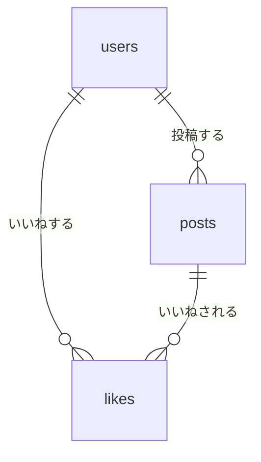

# データベース設計

## 1. 前提と用語

[要件定義](requirements.md)と[ルーティング設計](routes.md)、その後の会話での決定をもとに、SQLiteとPeeweeで実装する。

- 名前・表示名は保存しない。登録・ログインはメールアドレスとパスワードで行う。
- メールアドレスは前後の空白だけを除去し、大文字・小文字を区別する。
- ユーザー登録日時と投稿日時を保存し、いいね日時は保存しない。
- 写真は1投稿に1枚。画像本体はローカルに保存し、DBにはアプリが生成したファイル名を保存する。
- いいねは必須機能。コメントやフォローのテーブルは今回作らない。

| 用語 | 意味 |
|---|---|
| 主キー（PK） | 各行を一意に識別するID |
| 外部キー（FK） | 別テーブルの行を参照するID |
| NOT NULL | 値の欠落を許可しない制約。空文字を禁止する意味ではない |
| ユニーク制約 | 同じ値や同じ組み合わせの重複を禁止する仕組み |
| インデックス | 検索や並べ替えを助ける索引。増やすと保存時の処理や容量も増える |

## 2. テーブル一覧と関係

| テーブル名 | Peeweeモデル名 | 役割・必要な理由 |
|---|---|---|
| `users` | `User` | ログインする人を管理する。投稿者の情報を各投稿に重複保存せず、IDで結び付けられる |
| `posts` | `Post` | 写真投稿を1件ずつ保存する。写真、キャプション、投稿者、日時をまとめて扱える |
| `likes` | `Like` | 「誰が、どの投稿にいいねしたか」を1行で保存する。件数だけでは分からない、いいね済み判定・取り消し・重複防止に必要 |

ユーザー1人は0件以上の投稿を持ち、各投稿の投稿者は必ず1人。ユーザーと投稿は、いいねを通じて多対多にも結び付く。各いいねにはユーザー1人と投稿1件が必要となる。

## 3. カラム設計

以下の型はPeeweeで指定する型とSQLite上の宣言型を示す。全カラムを必須（NOT NULL。主キーは主キーの規則による）とする。キャプションの未入力はNULLではなく空文字に統一する。

### 3.1 users：ユーザー

| カラム名 | SQLite宣言型 | Peewee型 | キー・制約 | 内容・初期値 |
|---|---|---|---|---|
| `id` | INTEGER | `AutoField` | PK | DBが自動採番するユーザーID |
| `email` | VARCHAR(254) | `CharField` | UNIQUE、BINARY照合 | メールアドレス。初期値なし |
| `password_hash` | TEXT | `TextField` | NOT NULL | パスワードのハッシュ値。平文は保存しない |
| `created_at` | DATETIME | `DateTimeField` | NOT NULL | 登録日時。作成時の現在日時 |

- `Alice@example.com` と `alice@example.com` は別の値として登録できる。
- 登録・ログイン・重複確認すべてで、大文字・小文字を区別した完全一致を使う。小文字化や大文字・小文字を無視する検索は行わない。
- `email` の照合順序をBINARYにして、ユニーク制約にも同じ比較規則を適用する。
- パスワード確認欄の値、平文パスワード、名前は保存しない。
- メールアドレス最大254文字は、実装上の既定値として採用する。

### 3.2 posts：投稿

| カラム名 | SQLite宣言型 | Peewee型 | キー・制約 | 内容・初期値 |
|---|---|---|---|---|
| `id` | INTEGER | `AutoField` | PK | DBが自動採番する投稿ID。詳細URLの `post_id` に使う |
| `user_id` | INTEGER | `ForeignKeyField` | FK → `users.id`、NOT NULL | 投稿者のID |
| `image_filename` | VARCHAR(255) | `CharField` | UNIQUE、NOT NULL | アプリが生成した画像保存名。初期値なし |
| `caption` | VARCHAR(200) | `CharField` | NOT NULL、長さ200以下のCHECK | 任意の説明文。未入力時は空文字 |
| `created_at` | DATETIME | `DateTimeField` | NOT NULL | 投稿日時。作成時の現在日時 |

- 画像名はアップロード用ディレクトリからのファイル名のみとし、絶対パスや元のファイル名は保存しない。
- 画像名を一意にし、別の投稿が同じ保存ファイルを共有しないようにする。
- 一覧は `created_at` の降順、同じ日時の場合は `id` の降順で表示する。
- いいね数は `likes` の件数から求め、投稿に別カラムとして保存しない。更新漏れによる件数のずれを避けるためである。

### 3.3 likes：いいね

| カラム名 | SQLite宣言型 | Peewee型 | キー・制約 | 内容・初期値 |
|---|---|---|---|---|
| `id` | INTEGER | `AutoField` | PK | DBが自動採番するいいねID |
| `user_id` | INTEGER | `ForeignKeyField` | FK → `users.id`、NOT NULL | いいねしたユーザー |
| `post_id` | INTEGER | `ForeignKeyField` | FK → `posts.id`、NOT NULL | いいねされた投稿 |

- `user_id` と `post_id` の組み合わせに複合ユニーク制約を付ける。
- 各列を単独でユニークにはしない。1人が複数投稿にいいねでき、1投稿が複数人からいいねされるためである。
- 取り消し時は該当行を削除する。履歴や取消フラグ、いいね日時は持たない。
- 自分の投稿へのいいねは禁止しない。既存要件に制限がないため、同じルールを適用する。

## 4. 外部キーと削除時の動作

| 外部キー | 参照先 | 親が削除される場合の動作 |
|---|---|---|
| `posts.user_id` | `users.id` | RESTRICT：投稿があるユーザーの削除を拒否する |
| `likes.user_id` | `users.id` | RESTRICT：いいねがあるユーザーの削除を拒否する |
| `likes.post_id` | `posts.id` | CASCADE：投稿と一緒に関連するいいねを削除する |

- ユーザー削除機能は今回の対象外。誤って関連データを削除しないよう、ユーザーへの参照はRESTRICTを既定とする。
- 投稿削除は実データを削除する方式とし、削除フラグや復元機能は作らない。
- DBのCASCADEは画像ファイルを削除しない。画像の削除はアプリ側で別途行う。
- 外部キーは「存在するユーザー・投稿か」を保証する。削除してよい本人かどうかは、ログイン情報を使ってアプリ側で確認する。

## 5. ユニーク制約とインデックス候補

| 対象 | 種類 | 方針・用途 |
|---|---|---|
| 各テーブルの `id` | 主キー | 必須。IDによる取得に利用。追加の同一索引は不要 |
| `users.email` | ユニーク | 必須。メール重複防止とログイン時の検索 |
| `posts.image_filename` | ユニーク | 必須。画像保存名の重複防止 |
| `likes(user_id, post_id)` | 複合ユニーク | 必須。同じ投稿への重複いいね防止といいね済み判定 |
| `posts.user_id` | 通常インデックス | 初版で採用。投稿者にひも付く投稿の検索を補助 |
| `likes.post_id` | 通常インデックス | 初版で採用。投稿別の件数集計や投稿削除時の処理を補助 |
| `likes.user_id` | 通常インデックス | 個別追加は不要。先頭列が `user_id` の複合ユニーク索引を利用できる |
| `posts(created_at, id)` | 複合インデックス | 追加候補。投稿数が増えて一覧の並べ替えが遅くなったら検討する |

初版ではユニーク制約に伴う索引と必要な外部キー索引を用意し、キャプションやハッシュ値には索引を付けない。

## 6. Peeweeで実装する場合の注意点

### 6.1 モデル名・外部キー・索引

- モデルのテーブル名を `users`、`posts`、`likes` に明示して、設計と実際の名前を合わせる。
- モデルの外部キーフィールド名は `user`、`post`、DBカラム名は `user_id`、`post_id` とする。Peeweeでは対応するIDを `_id` 付きの属性で取得できる。
- 複合ユニーク制約は `Like` の `Meta.indexes` で指定する。ここではモデルのフィールド名 `user` と `post` を使う。
- 外部キーフィールドの自動索引と手動の索引が重複しないよう確認する。`Like.user` は単独索引を無効にし、複合ユニーク索引を使う。

これらのフィールド・索引の指定方法は [Peewee公式のモデル設計資料](https://docs.peewee-orm.com/en/latest/peewee/models.html)を参照する。

### 6.2 SQLiteの制約を有効にする

- SQLite接続では `foreign_keys` PRAGMAを有効にする。宣言だけでは外部キーやCASCADEが期待どおりに働かない場合がある。
- 主キーは `AutoField` を使う。SQLiteでは削除したIDが再利用される場合があるので、永久に再利用されない番号とは扱わない。

この挙動は [Peewee公式APIのAutoField説明](https://docs.peewee-orm.com/en/latest/peewee/api.html#AutoField)に従う。

- SQLiteではVARCHARの宣言上の長さだけに頼らず、フォーム入力をサーバー側で検証する。キャプションはDBにも長さ200以下のCHECK制約を設定する。
- メールと画像保存名も、表で決めた最大長以内かアプリ側で検証する。必須の文字列は空文字も拒否する。

### 6.3 日時の扱い

- 実装上の既定として、登録日時・投稿日時はUTCに統一して保存し、表示時に日本時間へ変換する。
- `DateTimeField` にはUTCとして扱うタイムゾーン情報なしの日時を保存する。ローカル時刻と混在させない。
- 現在日時の初期値は、レコードを作るたびに評価される関数として指定する。起動時に一度だけ作った日時を使い回さない。[Peewee公式の初期値の説明](https://docs.peewee-orm.com/en/latest/peewee/models.html)
- これらの初期値はPeewee側の設定である。直接SQLで追加する場合も、必須の値を渡す必要がある。

### 6.4 登録・いいね・ファイルの整合性

- 重複の事前確認だけでなく、DBのユニーク制約でも防止する。同時送信などで `IntegrityError` が発生した場合は、重複なのかを確認して適切に処理する。
- いいね済みへの追加、未いいねへの取り消しは、既存ルートの方針どおり状態を変えずに詳細へ戻す。
- 複数のDB変更をまとめる場合はトランザクションを使用する。Peeweeでは `atomic()` を使い、失敗した処理を途中まで確定しない。
- DBのロールバックで画像ファイルは元に戻らない。投稿保存失敗時の画像の片付けと、投稿削除時のファイル削除失敗を別途扱う。削除失敗は記録し、残ったファイルを確認・除去できるようにする。
- パスワードは認証用のハッシュ化関数で処理してから保存する。ログやエラーメッセージにも平文を出さない。

### 6.5 取得処理と変更管理

- 一覧では投稿ごとに毎回いいね件数を問い合わせず、対象投稿の件数をまとめて集計する。いいね0件の投稿も表示する。
- DBへの接続はリクエストに合わせて管理し、処理終了時は例外の有無にかかわらず閉じる。
- テーブルを作成する処理は、既存テーブルのカラムや制約を自動更新するものではない。設計変更時は既存データを保つ移行を別途考える。
- DBファイルとアップロード写真はGitに登録しない。

## 7. 実装後に確認すること

- 同一表記のメールは重複登録できず、大文字・小文字だけが異なるメールは別々に登録できる。
- メールの前後の空白は除去され、ログイン時も登録時と同じ比較規則になる。
- 平文パスワードや名前が保存されていない。
- ユーザー1人で複数投稿でき、存在しないユーザーの投稿は保存できない。
- キャプション未入力は空文字で保存され、201文字以上は拒否される。
- 重複画像名と、同じユーザー・投稿への重複いいねがDB側で拒否される。
- 複数ユーザーが同じ投稿にいいねでき、取り消すと件数が減る。
- 投稿削除で関連するいいねが消え、画像ファイルも削除される。
- 登録日時・投稿日時が作成時に記録され、表示時に日本時間になる。
